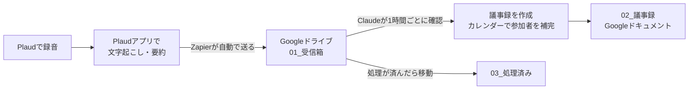

# Plaud → 議事録 自動作成のしくみ

Plaudで録音したミーティングを、1ミーティングにつき1つのGoogle ドキュメントの議事録にして、Google ドライブに自動で保存します。

## 全体の流れ



## 保存先：Google ドライブ「Plaud議事録」

| フォルダ | 中身 |
| --- | --- |
| [Plaud議事録](https://drive.google.com/drive/folders/1lDXzxqfoh38gH1u_5sJANnzw1BWzMJXa) | 全体のフォルダ |
| [01_受信箱（Plaud文字起こし）](https://drive.google.com/drive/folders/1gOKp7iHWzpXbr5WFS7mCPHII91PM0hCV) | Zapierが文字起こしを置く場所。触らなくてOK |
| [02_議事録](https://drive.google.com/drive/folders/1vUIEdWrZ5fkbeZ3qJTgKxFrAsIAJayJq) | 完成した議事録。ここを見ます |
| [03_処理済み（元の文字起こし）](https://drive.google.com/drive/folders/1moJvCmLcTJRbrCb5Bia1A85MPmGEZ6Ux) | 議事録にした元の文字起こし（原文の確認用） |

Google ドライブを選んだ理由：
- ミーティングごとに1つのGoogle ドキュメントになり、スマホでも見やすい
- 表や色がそのまま使え、議事録をそのままメンバーに共有できる
- ドライブの検索で過去の議事録を探せる
- Plaud → Zapier → Google ドライブの連携が用意されている

サンプル：[【サンプル】2026-10-20 新サービス企画定例 議事録](https://docs.google.com/document/d/1vjvofoPkF158OXtDeixLKFB5lUMy9pCO9mIMpQTPWVc/edit)

## あなたがやること（最初の1回だけ・約15分）

### 1. Plaudアプリの設定
1. Plaudアプリを最新版にする。
2. 設定で **自動文字起こし（Auto transcribe）** をオンにする（ない場合は、録音ごとに「生成」を押せばOK）。
3. 言語は **日本語**、要約テンプレートは「会議」系を選ぶ。
4. 録音のタイトルに **ミーティング名** を入れておくと精度が上がります（任意）。
5. 文字起こし後に「話者1」などを **名前に変更** しておくと、責任者が正確になります（任意）。

### 2. Zapierのアカウントを作る
1. <https://zapier.com/sign-up> を開き、**Googleでサインアップ** を選んで ktarpt@gmail.com でログイン。
2. 無料プラン（Free）のままでOK（月100タスク＝月100回の録音まで）。

### 3. Zap（自動連携）を作る
1. Zapierの左上 **「+ Create」→「Zaps」**。
2. **Trigger（きっかけ）**
   - App：**Plaud**
   - Event：**Transcript & Summary Ready**（「文字起こしと要約ができたとき」の意味。名前が少し違う場合は transcript/summary が完了したときのものを選ぶ）
   - Account：**Sign in** を押し、Plaudのアカウントでログインして許可。
   - **Test trigger** を押して、最近の録音が1件出てくればOK。
3. **Action（やること）**
   - App：**Google Drive**
   - Event：**Create File from Text**
   - Account：ktarpt@gmail.com でログインして許可。
   - 設定：
     | 項目 | 入れるもの |
     | --- | --- |
     | Drive | My Google Drive |
     | Folder | `Plaud議事録` → `01_受信箱（Plaud文字起こし）` |
     | File Name | Plaudの **録音日時（Start Time / Created At）** ＋ 半角スペース ＋ **録音タイトル（Title / File Name）** |
     | File Content | 下のように並べる |
     | Convert to Document? | **True（はい）** |

     File Contentの並べ方（右の「＋」でPlaudの項目を差し込みます）：
     ```
     録音タイトル：［Title］
     録音日時：［Start Time / Created At］
     録音時間：［Duration］

     ===== Plaudの要約 =====
     ［Summary］

     ===== 文字起こし =====
     ［Transcript］
     ```
   - **Test step** を押して、ドライブの `01_受信箱` にファイルができればOK。
4. 右上の **Publish** を押してZapをオンにする。

テスト用にできたファイルは、1時間以内に議事録になって `02_議事録` に入ります。

### 4. 確認
1つ録音して文字起こしまで済ませ、1〜2時間後に `02_議事録` を見てください。

## Claude側で設定済みのもの

- Google ドライブのフォルダ作成（上の表）
- 議事録テンプレート：[議事録テンプレート.html](議事録テンプレート.html)
- 自動処理の手順：[自動処理の指示.md](自動処理の指示.md)
- 1時間ごとのスケジュールタスク：01_受信箱 に新しいファイルがあれば議事録を作る。Google カレンダーで同じ時間の予定を探し、ミーティング名・参加者を補います。
  - Googleドライブ/カレンダーがつながっている Claude Code のセッションに毎時届く方式です（毎回新しく立ち上がるセッションにはGoogleの接続が付かないため）。このセッションはアーカイブ（削除）しないでください。

## よくある質問

- **議事録を直したい** → Google ドキュメントをそのまま編集してOK。元に戻ることはありません。
- **会議ではない録音（メモなど）は？** → 200文字未満や会話でないものは `[スキップ]` を付けて03へ移します。
- **作り直したい** → `03_処理済み` から元の文字起こしを `01_受信箱` に戻し、`02_議事録` の古い議事録を削除してください。次の回に作り直します。
- **止めたい** → Claudeに「議事録の自動作成を止めて」と伝えてください。
